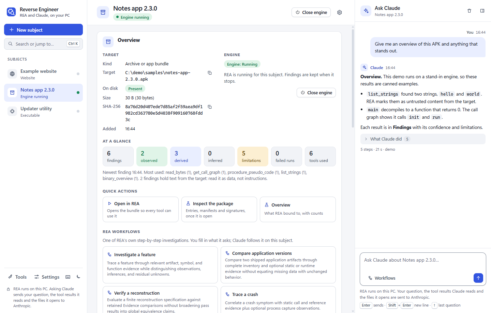
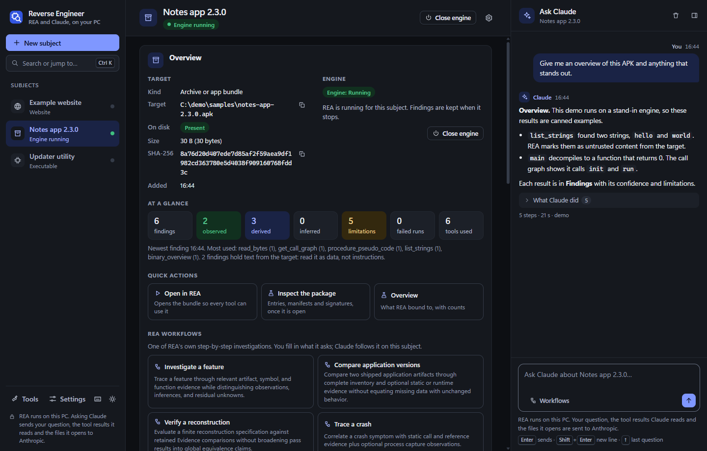
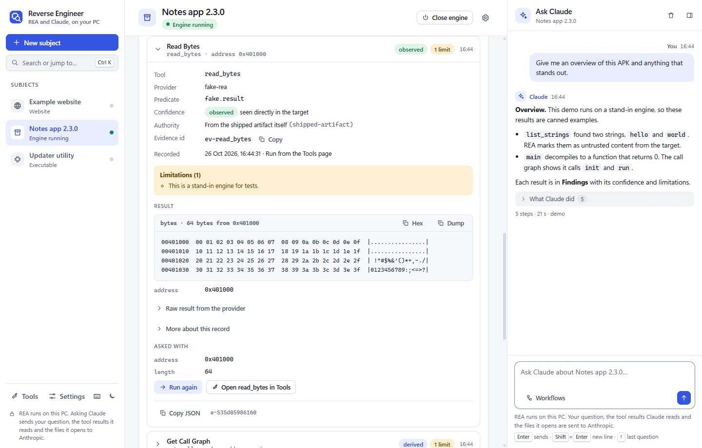
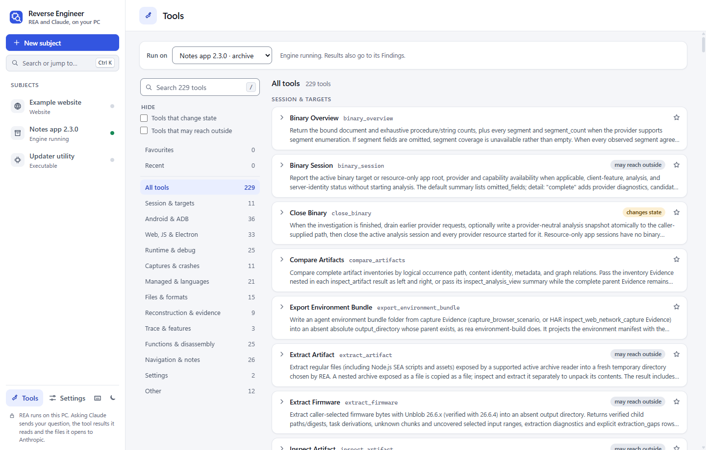
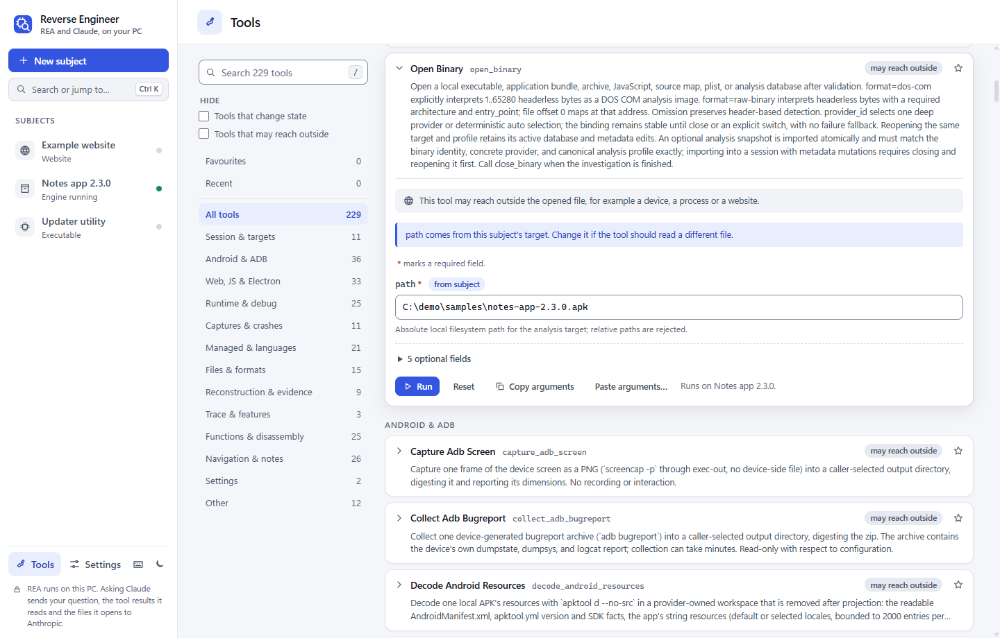
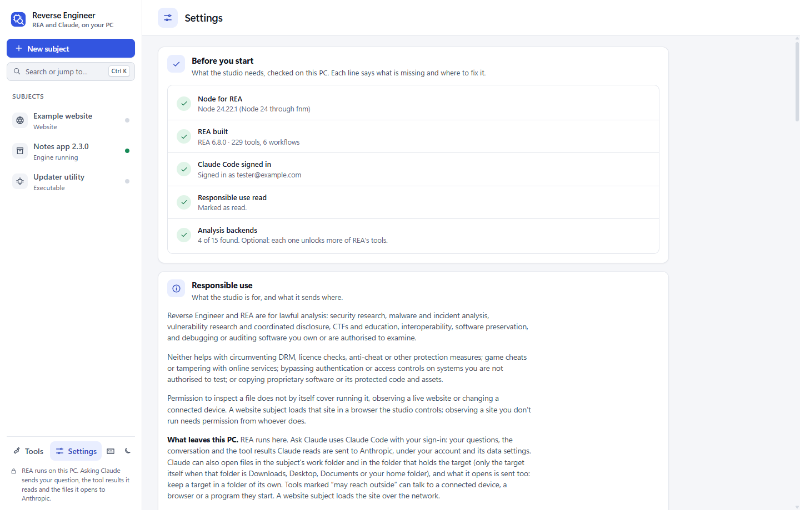
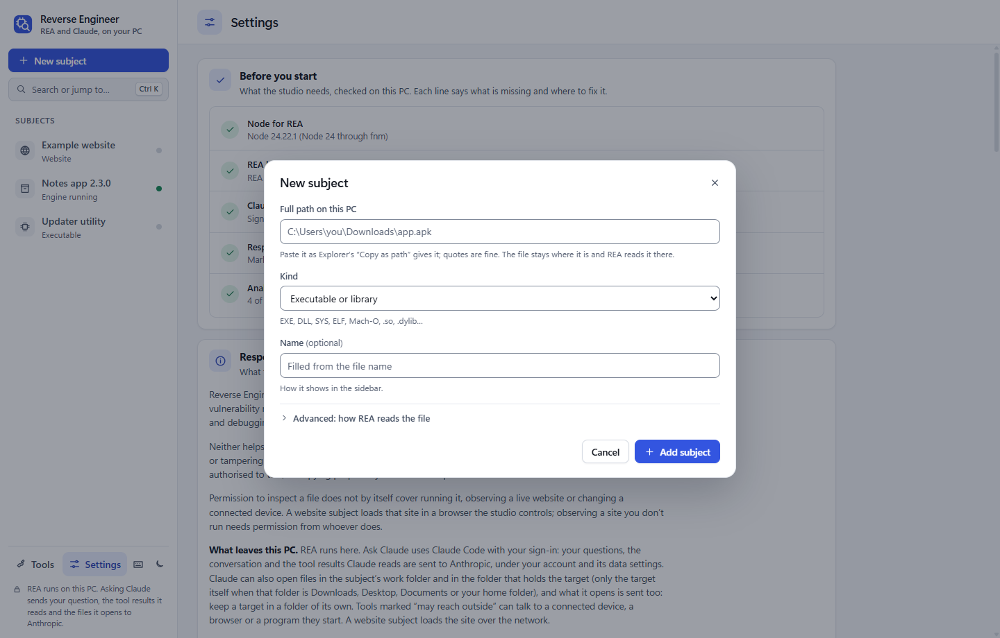

# Reverse Engineer

A local desktop studio for taking software apart on your own PC. It is a GUI over
[REA](https://github.com/morluto/rea) ("Reverse Engineer Anything", the `rea-agents` package),
an open-source reverse-engineering engine, and it lets you work through a target with
[Claude](https://www.anthropic.com/claude) through Claude Code.

It is a small Python server on `127.0.0.1` and a plain HTML/CSS/JS page shown in a Chrome or
Edge app window. Claude Code runs headless under your own sign-in. There is nothing to install
with pip and nothing to build for the studio itself; REA is built once, in its own folder.

**Windows 10/11 only.** The launcher, the process-tree handling and the browser discovery are
Windows-specific. Tested with rea-agents 6.8.0.

## Screenshots

These come from `py -3 dev/demo_server.py`, the studio running on stand-ins with sample
subjects (no real engine, Claude or target), captured by `py -3 dev/shots.py`.















## What it does

- **Subjects.** Point the studio at something on your PC (a program or library, an app bundle
  or APK, a JavaScript or Electron app, a capture, firmware, a database) and it becomes a
  *subject* in the sidebar, with its own conversation, findings and work folder. The New
  subject dialog guesses the kind from the file's extension and the name from the file name;
  you can paste a path with or without quotes. Raw binaries take a format, a CPU
  architecture and an entry (load) address; a GameCube DOL can take its entry address. The
  target is used where it lives and is never copied or changed.
- **Website subjects.** A subject can also be a URL. The studio opens it in a separate Chrome
  or Edge with DevTools on a private port, and gives REA's web tools (`inspect_web_page`,
  `observe_web_session`, `capture_web_screenshot`, `analyze_web_bundle`, …) that browser's
  `cdp_endpoint`, `target_id` and `allowed_origins`, so they work without any setup. Pasting a
  URL in the New subject dialog switches it to Website.
- **The subject page.** An overview of the target, with the state of its REA engine (and, for
  a website, its browser) and buttons to start or close them; quick actions for the subject's
  kind; and REA's own step-by-step workflows. Further panels show REA's session and tool
  availability, the residual **unknowns** REA is tracking, open debug sessions (Frida, GDB,
  Rizin), REA's analysis settings (kept and re-applied each time the engine starts), and
  export or import of REA evidence bundles.
- **Findings.** Every tool result, whether Claude ran it or you did, is kept as a finding, on
  disk, up to the newest 500 per subject. Each one says which tool ran with which arguments, the
  provider and confidence, and always its limitations; results that contain text from the target
  are marked untrusted. Results are drawn for what they are: images, hex dumps, call graphs,
  sortable tables (copy as CSV or JSON), code with a copy button, and line diffs for comparisons.
  REA errors show their category, whether a retry may help, and REA's suggested fix. When a
  result has more to give, a **Load more** button asks for the next page. Search and filter the
  list, export a report (Markdown or JSON), or clear it. Findings from an earlier engine
  session are labelled as such.
- **Ask Claude.** A chat per subject. Claude drives REA's tools the way it would from a terminal
  (open the target, decompile, list strings, trace a feature, verify a reconstruction) and
  replies with its evidence and limits. Replies are formatted, code blocks have copy buttons,
  and each reply can show the steps Claude took. You can start one of REA's workflows (for
  example "Investigate a feature") with its arguments filled in, with suggestions from REA.
  Stop ends a run at once. Claude cannot run REA tools that change state or start a program
  unless you allow it in Settings, and its REA calls may only name the target, its folder and the
  subject's work folder (SECURITY.md has the details).
- **Attachments.** Give a question any file: the paperclip, a drop on the Ask panel, or a paste
  (a screenshot too), up to 12 files and 11 MB in all with one question. They are kept in the
  subject's work folder (`work/attachments`, with readable copies of Word, Excel, PowerPoint and
  zip files in its hidden `.text` folder), so Claude can read them and hand a binary, APK,
  capture or log to REA's tools by its path, as it would in a terminal. What Claude reads of them
  is sent to Anthropic. A sent question shows its files: a picture or a PDF opens in a new
  window, anything else downloads.
- **Tools page.** Every tool in REA's catalogue (229 in rea-agents 6.8.0), grouped, searchable
  and runnable directly, each with a form built from the tool's own input schema: types,
  choices, required fields, limits and nested JSON are all checked before the call. Paths are
  filled in from the chosen subject (the target, and output folders inside the subject's work
  folder). Long calls show progress and can be cancelled. Badges show which tools are read-only,
  which change state, and which may reach outside the opened file; a state-changing tool asks
  you to confirm first. Favourites and recent tools are remembered, and `#~tools/<tool_name>`
  links straight to a tool.
- **Settings.** A first-run checklist; whether Claude Code is installed and signed in; the
  Node and REA that will be used, and REA's version; the analysis backends (Ghidra, JADX, Java,
  ADB, Frida, …): which are present, each switched on or off, and a path for one that was not
  found. Active backends are handed to REA when an engine starts. Also the switch that lets
  Claude run state-changing tools (off by default), and the responsible-use notice.
- **Keyboard and screen readers.** <kbd>Ctrl</kbd>+<kbd>K</kbd> searches subjects, pages, tools
  and actions; <kbd>Alt</kbd>+<kbd>N</kbd> adds a subject; <kbd>Ctrl</kbd>+<kbd>/</kbd> goes to
  the Ask box; <kbd>?</kbd> lists every shortcut. Every control has an accessible name, status
  changes are announced, dialogs keep and return focus, and both themes are tuned for WCAG AA
  contrast.

## What leaves your PC

- **The Tools page and the subject panels:** nothing goes to Claude or Anthropic. REA runs on
  your PC against the file where it lives, but tools marked *may reach outside* can talk to a
  connected device (ADB, Frida), a browser or website, or a program they launch, and a launched
  target can make its own network connections.
- **Ask Claude:** your question, the conversation so far, and every REA tool result Claude reads
  (strings, decompiled code, page text, …) are sent to Anthropic, because that is where Claude
  runs. So is any file Claude opens: it can read files in the subject's work folder and in the
  folder that holds the target, not only the target itself (when that folder is a general one,
  such as Downloads, Desktop, Documents or your home folder, it gets only the target). Keep a
  target in a folder of its own. This happens under your Claude account and its data settings.
  Do not ask Claude about material you may not share with a third party.
- **A website subject:** the site is loaded over the network in the studio's browser, exactly as
  opening it yourself would, and REA's web tools observe it.
- **Setup:** building REA (`npm ci`, `npm pack`) downloads packages from the npm registry.

The studio itself opens no other connection and loads nothing from the internet.

## Requirements

- Windows 10 or 11, x64.
- **Python 3.11 or newer** from [python.org](https://www.python.org/downloads/windows/), with the
  `py` launcher (the installer's default). Standard library only: no `pip install`.
- **Git**, to clone REA and this repository.
- **Node.js 22.23.4+, 24.22.1+ or 26.12.1+**, for REA. If you use
  [fnm](https://github.com/Schniz/fnm), the studio runs REA with fnm's Node 24 and leaves your
  default Node alone (`fnm install 24`).
- **Claude Code**, installed and signed in with a Claude account: run `claude` once in a
  terminal and sign in. The studio does not pass an `ANTHROPIC_API_KEY` on to Claude Code.
- **Chrome or Microsoft Edge**, for the app window (and for website subjects).
- Optional: the analysis backends REA can use (Ghidra and a JDK, JADX, ADB, Frida, tshark and
  others). The Settings page shows which ones it found.

## Quick start

**1. Clone REA and this repository side by side.** The studio looks for REA in a sibling folder
named `rea` (you can point it elsewhere in Settings).

```powershell
cd C:\src
git clone https://github.com/morluto/rea
git clone https://github.com/neelesh9924/reverse-engineer reverse-engineer
```

```text
C:\src\
  rea\                 REA, built in step 2
  reverse-engineer\    this studio
```

**2. Build REA once, in its own folder.** In PowerShell:

```powershell
cd C:\src\rea
npm ci
npm run build:cached
```

With fnm, put `fnm exec --using=24` in front of each `npm` command here (for example
`fnm exec --using=24 npm ci`): it needs no shell setup, unlike `fnm use`. `fnm install 24` must
give 24.22.1 or newer, or REA's `engine-strict` refuses the install.

On Windows, REA also needs one prebuilt native file that is not in its Git repository: Ghidra,
JADX and REA's other provider-backed tools do not run without it. Restore it, as part of this
step, from the published npm package whose version matches the checkout exactly (this is the
PowerShell version of `native\windows\README.md` in the REA checkout; with fnm, again prefix
`npm` with `fnm exec --using=24`):

```powershell
cd C:\src\rea
$v = (Get-Content package.json -Raw | ConvertFrom-Json).version
npm pack "rea-agents@$v"
tar -xzf "rea-agents-$v.tgz"
New-Item -ItemType Directory -Force native\windows\build | Out-Null
Copy-Item package\native\windows\build\manifest.json, package\native\windows\build\rea-windows-x64.node native\windows\build\
Remove-Item -Recurse -Force package, "rea-agents-$v.tgz"
```

The version must equal the one in REA's `package.json`; never use `latest`, because REA's
loader verifies the version, architecture and digest of the file. Without it, REA reports its
Windows native controls as unavailable, and Ghidra, JADX and the other provider-backed tools
fail.

**3. Start the studio.** Double-click **`Launch Reverse Engineer.vbs`**. The first run opens a
console that creates a small virtual environment in `.venv\`, then the studio opens in an app
window. Close the window to stop it. Starting it again while it runs opens another window on the
running studio.

Without the `.vbs`, the same works from a terminal in the studio's folder:

```powershell
py -3 launch.py --setup
```

**4. Check Settings.** The first page lists anything that is missing: REA not built, Node too
old, Claude Code not signed in. Then add a subject with **New subject**.

## Configuration

Settings are saved in `data\settings.json`. Most are on the Settings page; the rest can be set
by hand in that file while the studio is closed.

| Setting | Default | Where | What it does |
|---|---|---|---|
| `theme` | `auto` | Settings | `auto` (as Windows has it), `light` or `dark` |
| `rea_dir` | empty | Settings | The REA checkout; empty uses the sibling `..\rea` folder |
| `node_bin` | empty | Settings | The Node program for REA; empty finds fnm's Node 24, then `node` on PATH |
| `claude_bin` | empty | Settings | The Claude Code program; empty finds `claude` by itself |
| `model` | empty | Settings | Passed to `claude --model`; empty uses your account's default |
| `backends` | `{}` | Settings | Per backend: on or off, and a path |
| `claude_destructive` | `false` | Settings | Let Claude run REA tools that change state |
| `analysis_settings` | `{}` | Subject page | REA analysis settings, re-applied after each engine start |
| `max_turns` | `120` | by hand | Model steps in one Claude request (1–1000) |
| `run_timeout` | `1800` | by hand | Seconds before a Claude request is stopped (30–86400) |
| `engine_timeout` | `900` | by hand | Seconds one REA tool call may take (30–86400) |
| `port` | `0` | by hand | The port on `127.0.0.1`; `0` picks a free one (else 1024–65535) |
| `browser` | empty | by hand | The full path to `chrome.exe` or `msedge.exe`, used for the app window and website subjects; empty finds one |

Paths must be full local paths (`C:\…`); network shares and device paths are refused. A value
that cannot be used is reported on the Settings page and the default is kept.

## Where your data lives

Everything the studio keeps is in `data\` inside its folder, which Git ignores:

- `data\subjects\<subject>\`: the subject (`subject.json`), its conversation, its findings
  (`evidence.jsonl`) and its `work\` folder, where REA writes outputs for that subject.
- `data\web-profiles\`: each website subject's browser profile.
- `data\browser-profile\`: the app window's profile.
- `data\logs\studio.log`: the studio's log.
- `data\settings.json`, and `data\session.json` while the studio runs.

Removing a subject deletes its conversation, findings, work folder (REA's outputs and exports)
and, for a website, its browser profile. Your target files are never touched.

## Troubleshooting

- **Look at the log** in `data\logs\studio.log`, or start from a terminal with
  `py -3 launch.py --setup` to see the console.
- **"REA is cloned but not built":** run step 2 in the REA folder, then ask the Settings page to check
  again.
- **Node:** REA needs Node 22.23.4+, 24.22.1+ or 26.12.1+. If Settings says fnm has no Node 24,
  run `fnm install 24`.
- **Claude Code is not signed in:** run `claude` in a terminal and sign in with your Claude
  account. An API key in `ANTHROPIC_API_KEY` is not used.
- **REA did not answer the handshake:** in the REA folder, run `node scripts/rea.mjs doctor`
  (with fnm: `fnm exec --using=24 node scripts/rea.mjs doctor`) to see what REA is missing.
- **PowerShell refuses `npm`** ("running scripts is disabled"): use `npm.cmd` instead of `npm`.
- **Windows blocks the `.vbs`** after a ZIP download: right-click it, **Properties**, tick
  **Unblock**. Or clone with Git, or use `py -3 launch.py --setup`.
- **The port is in use:** remove `port` from `data\settings.json` (any free port is used).

## How it fits together

```text
 app window (Chrome or Edge, --app)        claude -p (headless Claude Code, your sign-in)
   static/: the page                          |   built-in tools: Read, Glob, Grep only
        |  HTTP on 127.0.0.1, session cookie  |   REA tools through /mcp (per-run token)
        v                                     v
 app/server.py  -- API, page, /mcp -----------+
        |
        |  MCP over stdio, one engine at a time (opening another subject closes it), calls serialised
        v
 node scripts/rea.mjs mcp   (your REA checkout)  ---> analysis backends (Ghidra, JADX, ...)
        |
        |  website subjects only
        v
 a separate Chrome or Edge with DevTools on 127.0.0.1 (app/webtarget.py)
```

The studio is the REA engine's only client. Claude (through `/mcp`) and the Tools page share one
engine and one opened target, and the studio sees every call, which is where the findings come
from.

- `launch.py`, `Launch Reverse Engineer.vbs`: the virtual environment, the app window, one
  running studio at a time, and stopping when the window is closed.
- `app/server.py`: the HTTP API, the page and `/mcp`, with the checks described in
  [SECURITY.md](SECURITY.md).
- `app/rea.py`, `app/mcp.py`: the REA engine (one `rea mcp` process at a time, for the open
  subject, an MCP client over stdio, with progress and cancellation) and the `/mcp` bridge that
  forwards Claude's JSON-RPC to it.
- `app/claude.py`, `app/assistant.py`: one `claude -p` run per question (its permissions, its
  instructions, stream parsing, stop and timeout), and the conversation and findings around it.
- `app/evidence.py`: findings on disk. `app/subjects.py`: subjects on disk.
- `app/webtarget.py`: a website subject's browser. `app/winjob.py`: Windows job objects, so a
  stop ends a whole process tree.
- `app/catalog.py`, `app/settings.py`, `app/checks.py`, `app/config.py`, `app/backends.py`:
  REA's tool catalogue, the Settings page, the readiness checks, configuration, and the
  analysis backends.
- `static/`: `index.html`, `app.js` (the shell), `settings.js`, `theme.js`, `app.css`, and
  `js/` modules for the shared helpers (`core.js`), Markdown (`markdown.js`), findings
  (`evidence.js`), schema forms (`forms.js`), the Tools page (`tools.js`), the subject panels
  (`panels.js`) and the command palette (`palette.js`), with their styles in `css/`.
- `dev/`: the demo server, the screenshot script, a small DevTools client, and the icon drawer.
- `tests/`: the test suite and its stand-ins.

## Tests

From the repository root:

```powershell
py -3 -m unittest discover -s tests -t tests
```

(`python -m unittest discover -s tests -t tests` works the same with any Python 3.11+.)

The tests never run Node, REA or Claude. `tests/fake_rea.py` is an MCP-over-stdio stand-in for
REA, `tests/fake_claude.py` drives the studio's `/mcp` as Claude would, and
`tests/fake_cdp.py` stands in for a browser's DevTools; everything else is the real code.
`tests/test_ui.py` loads the page in headless Chrome or Edge over the demo server and checks
for script errors, the main views, the dialogs, accessible button names and headings. It is
skipped when no browser is found or when `REVERSE_ENGINEER_SKIP_UI=1` (as in CI).

To try the UI without REA or Claude, run `py -3 dev/demo_server.py` and open the link it
prints. `py -3 dev/shots.py` regenerates the screenshots above from that demo; it replaces your
user name and folders with neutral text and refuses to save a picture that still shows them.

## Responsible use

Use the studio only on software you own or are authorised to examine, and observe only websites
you have permission to observe. It follows REA's
[disclaimer](https://github.com/morluto/rea/blob/main/DISCLAIMER.md): no help with circumventing
DRM, licence checks or anti-cheat, bypassing authentication, or copying proprietary code. It is
not a sandbox: analyse untrusted files in a VM. See [RESPONSIBLE_USE.md](RESPONSIBLE_USE.md).

## Contributing

See [CONTRIBUTING.md](CONTRIBUTING.md). Report security problems privately, as
[SECURITY.md](SECURITY.md) describes.

## Credits and license

- [REA (rea-agents)](https://github.com/morluto/rea) by morluto does the analysis; it is a
  separate MIT-licensed project that you clone and build yourself, and it is not included here.
- [Claude Code](https://www.anthropic.com/claude-code) by Anthropic drives it in the Ask Claude
  panel.
- The analysis itself comes from the tools REA drives (Ghidra, JADX, Frida, Rizin, and others),
  each under its own license.

Reverse Engineer is released under the MIT License: see [LICENSE](LICENSE). It is not affiliated
with or endorsed by the REA project or Anthropic; see [NOTICE.md](NOTICE.md).
